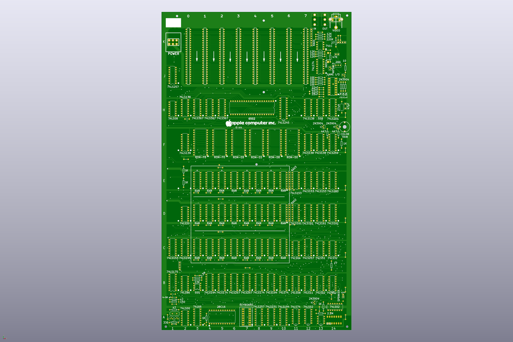
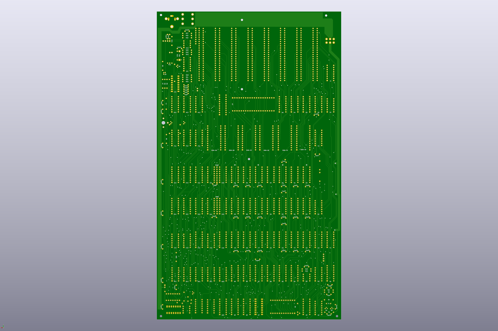

# Apple II Plus RFI Rev. 2 Clone

This board is a clone of the Apple II Plus RFI motherboard. It is designated as "Rev. 2"
to distinguish it from the original Apple II Plus RFI motherboard (which we refer to as "Rev. 0")
and the board from ReActiveMicro (which we refer to as "Rev. 1"). It was created
based on Mike Willegal’s Apple II Rev. 0 replica board.
While it is not 100% identical to the Apple or ReActiveMicro boards, it functions
exactly like an Apple II Plus RFI. The design has been verified against the
original schematics but has not been physically tested. USE AT YOUR OWN RISK.

## Changes done to Mike Willegal board

Removed E2 (74LS139)

Removed memory select jumpers (D1, E1 and F1)

Added A11 (74LS74), A12 (74LS02), A13 (555), A14 (74LS02) and B14 (74LS02)

Added R28 (1K - close to character generator EEPROM in the left side), R31 (1K - E1) and R32 (1K - E1)

A 5–50 pf trimmer capacitor (between A1 and B1 and above R2) has been added in series with the 14.318 MHz crystal.
(This was done because the original crystal is difficult to source; the trimmer
is used to fine-tune the color frequency.)

System ROMs (D0, D8, E0, E8, F0 and F8) have been replaced with 28C16 EEPROMs

Character ROM (A5) has been replaced with 28C16 EEPROM

The INH signal is inverted by A2 pins 9,10 and 8 before being connected to system EEPROMs pin 18 (ENABLE/) 

The 8T97s have been replaced with 74LS367 

The two 8T28s and have been replaced with one 74LS245

First "color kill" circuit has been added (Q6), triggered by TEXT MODE signal 

Second "color kill" circuit has been added (Q7), triggered by the AN2 signal (this does not exist in Apple II Plus RFI original board)

Video synchronization circuit updated (A14, B14 and part of C11)

Added colors orange and blue in high resolution (A11 and part of A12)

Power on reset circuit added (A13, part of A12, part of C11 & Q5)

The signal sync connected to slot 7 pin 19

The signal color ref connected to slot 7 pin 35

Test Connector added between B2 and C2

Soft 5 is connected to R28, instead being connected to A2 pins 8 and 11

